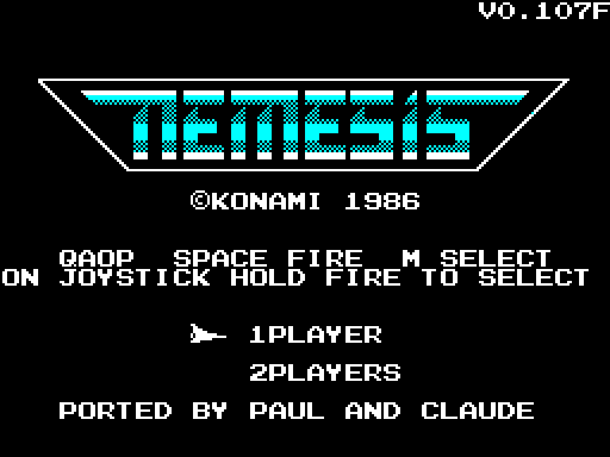
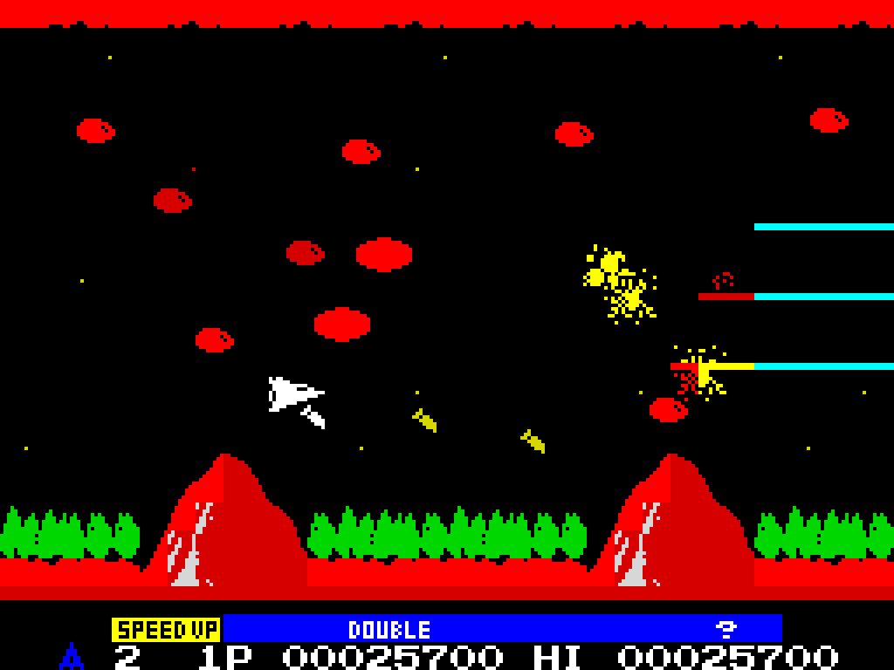
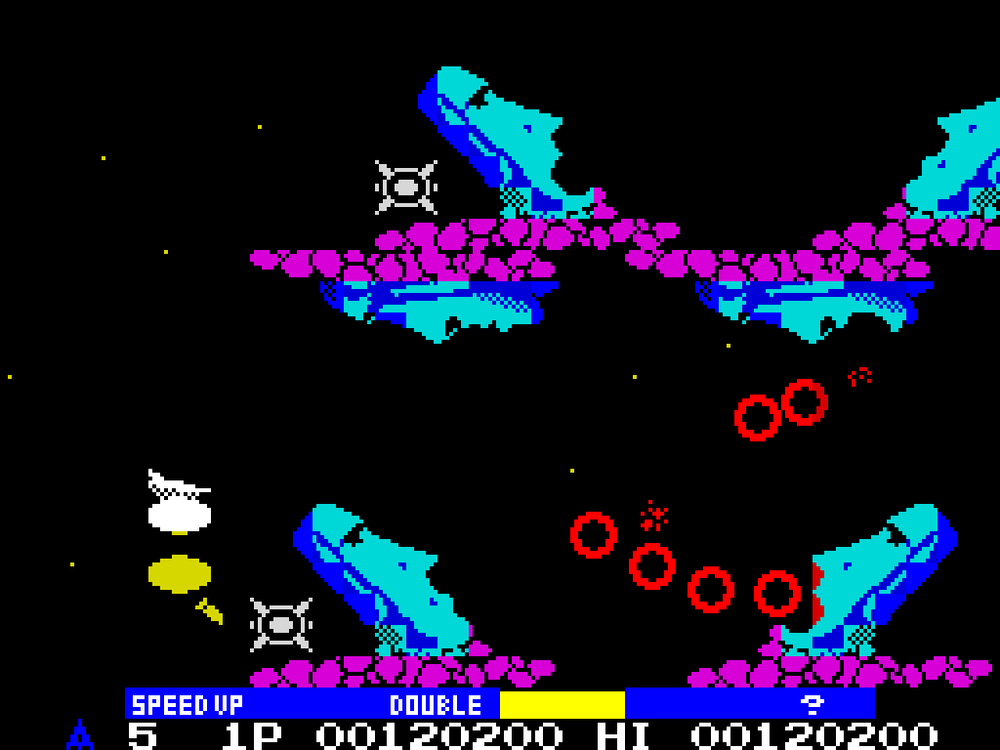
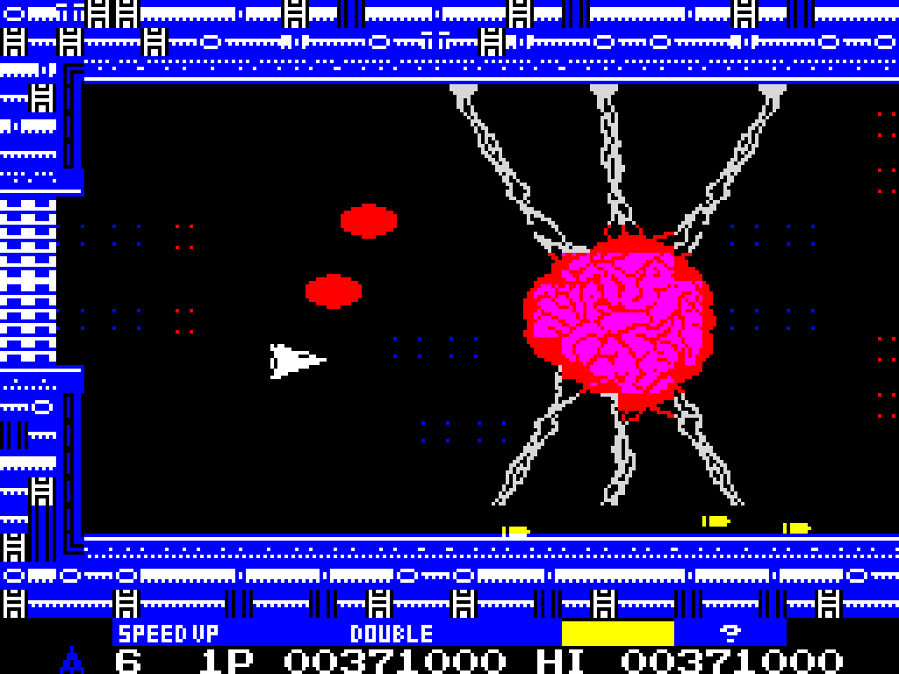
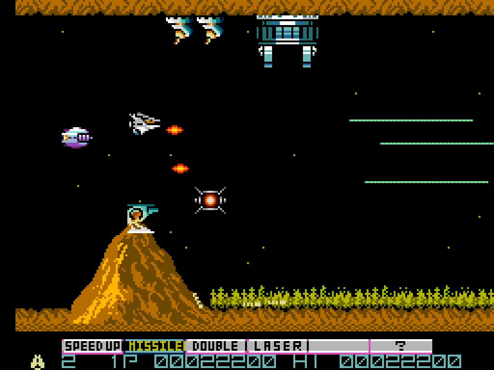
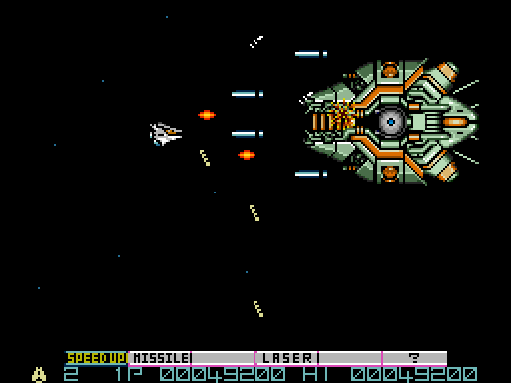
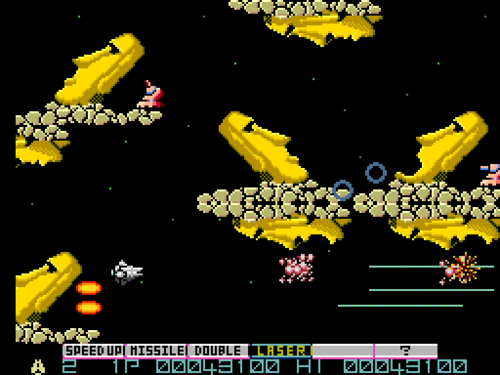
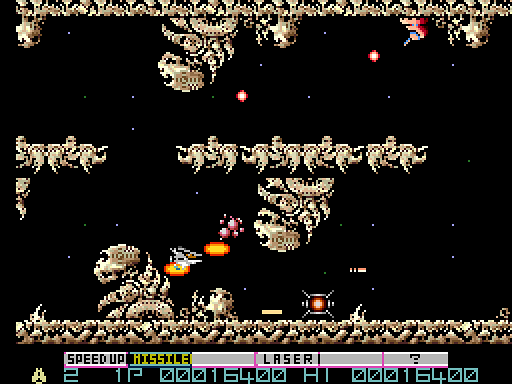
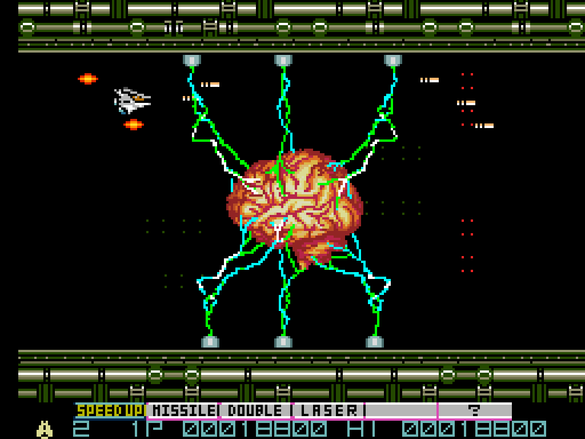

# Nemesis for the ZX Spectrum 128K

Nemesis, aka Gradius, was a seminal shmup. I first played it on a friend's C64, but we Spectrum owners were really shortchanged with the conversion we got. It didn't help that the mags of the era ran reviews featuring "screenshots" that were obviously mock-ups created by graphic artists. The game we got was a pale shadow of the game we were promised.

In contrast, the MSX was home turf for Konami, and like the vast majority of their titles they handled the conversion themselves. It was an excellent port that ran at a decent clip, maintained the playability of the original, and made sensible compromises to fit the game into the hardware platform.

Architecturally, the MSX wasn't THAT different to the Spectrum. Hardware sprites, yes, and slightly better colour attributes, but the same Z80 CPU, the same sound chip (at least compared to the Spectrum 128), same screen resolution. It would have made sense to use the MSX version of Nemesis as a basis for the Spectrum port.

So, this project is an attempt to tap into that alternate universe where that happened.

What we have here is a port of Konami's MSX cartridge Nemesis (RC-742, 1986) for running on a standard 128K Spectrum using Konami's own game code (tested on a real 128K and +3, loading from tape, and in emulation on the 128K, +2A and +3). It is mostly the same code that sits on top of a platform layer which stands in for the MSX hardware, apart from the graphics: those are converted for the Spectrum when the game is built, and loaded in place of Konami's own graphics loads.

The Z80 code of the cartridge is relocated to the Spectrum's memory by a generator (`reloc/gen.py`), and a platform layer (`spec/`) stands in for the hardware the code talks to: the memory mapper, the BIOS routines it calls, the video chip (TMS9918: the screen layout and the sprites), the sound chip (AY-3-8910, the same family as the 128K's) and the keyboard and joystick.

The game logic is Konami's, unchanged except where it meets the hardware. A test build matches the MSX original byte for byte in Konami's RAM, tick by tick (see [the technical description](docs/TECHNICAL.md), section 4).

Departures from the MSX original are all deliberate:

* The front end goes straight to the title screen: no Konami logo, no attract cycle (demo play and the illustration).  The title carries the controls and a credit line. This is to save on space - it was a tight fit!
* Colours are chosen for the Spectrum's attribute cells: tiles are fitted to two colours per cell when the game is built, sprites take one ink in each cell their pixels reach, and a few objects get colours of their own (technical description, sections 6.6 and 6.7). Where the automatic fit made a mess of the scenery (the bricks of stage 2 and the bonus stages, the Moai of stage 3, the brains of stages 6 and 8, the band and formations of stage 7 and the pipework of stage 8), the colours were picked by hand instead, stage by stage, against the MSX.
* The ship keeps the MSX's shape, but on the MSX it is two sprites one over the other: white, with a red canopy, and a light blue belly when it climbs. A Spectrum cell has one colour, so the canopy is drawn as a black line inside the white outline, and the belly as a stippled pattern.

Everything Konami made is still Konami's: see [LEGAL-NOTICE.md](LEGAL-NOTICE.md) for who owns what.

FULL DISCLOSURE: this is an AI project. The Claude in the credit is the Claude from Anthropic. I make no claim that I hand-wrote the code.

I guided the AI, brainstormed solutions to problems with it, proposed strategies for solving problems, gave direction on how best to accommodate modifications needed for the Spectrum. If you object to AI-authored code/projects then that is your prerogative, but perhaps then this project is not for you.






## The Spectrum Next version

The same game also builds for the ZX Spectrum Next, as a `.nex` file. It runs the same Konami code on the same platform layer, and uses the Next's hardware where the 128K has to make do:

* It runs at 28 MHz and at 30 game ticks a second, the speed of the original on a 60 Hz MSX, drawing every tick when there is time. Set to 60 Hz, the game and its music keep the same speed.
* The background is drawn on Layer 2, a byte per pixel, so the MSX's tiles keep their own colours instead of being fitted to attribute cells.
* The sprites are the Next's hardware sprites, in their MSX colours.
* The sound effects play on a second sound chip (the Next has three), so they are no longer lost when the music uses all three channels of the first.
* The screen scrolls smoothly, a pixel at a time, where the MSX moves the scenery a character (8 pixels) at a time. Enemies that Konami draws with characters are lifted out and drawn as sprites, so they move smoothly too.
* The graphics began as those of the MSX2 patch "Nemesis - Gradius ENHANCED" (V1.01, by Victor Martinez and Toni Galvez, based on SHALOM's). Over time most of these have been swapped out for graphics either from the arcade game or new original graphics. The graphics for the Next are kept in this repository (`spec/nxgfx/`) and changed from there, so the build does not need the patch.

The title screen shows the version ending in N: V1.2.1N. It has been played on a ZX Spectrum Next (KS2) and an N-Go, as well as in emulators.







## Playing it

### What you need

* A ZX Spectrum 128K, +2, +2A, +2B or +3. It needs the 128K's extra memory, so it won't run on a 48K. I have tested on a real 128K and a real +3 (from tape, through a Retroleum SmartCard and through a DivMMC Future), and in emulators as a 128K, +2A and +3.
* For the `.nex` file: a ZX Spectrum Next, or an emulator of one. I have tested on a KS2 Next and an N-Go (KS1 clone). It requires 1MB of RAM and the full ~~one point twenty-one jiggawatts~~ 28MHz so won't run on the early pre-release boards.

### Loading

* **Tape:** `LOAD ""` (on a +2A, +2B or +3, choose Loader from the menu). The loading screen builds up, then the game starts by itself.
* **Emulators:** the `.tap` files load like a real tape; the `.sna` files are 128K snapshots that start straight away.
* **Spectrum Next:** open the `.nex` file from the Next's browser, or load it in a Next emulator.

### One edition

Since 0.110 there is one edition. It draws every game tick while the game keeps up with the MSX's pace, and skips drawing one tick in two (no more) when it falls behind, so quiet stretches move smoothly and busy ones keep their speed. A tick in which the joystick or keys change direction is always drawn, so the ship answers a frame sooner. The title screen shows the version in the top right corner, ending in A: V1.2.1A. (The Spectrum Next version ends in N.)

Version 1.2 is about a tenth faster than 1.1.3 on the 128K and draws about a third more pictures a second. The Konami code and the screens it produces are the same. Version 1.2.1 gives stage 3's Moai heads and the rocks they stand on new colours on the 128K.

Versions 0.98 to 0.109 came in two editions, fast (one tick in two drawn) and smooth (four in five). Both can still be built (see Building).

### Controls

| Action | Keys | Joystick |
|---|---|---|
| Move | Q A O P, or 9 8 6 7 | Kempston, or Sinclair (keys 6-0) |
| Fire | SPACE or 0 | Fire |
| Power up | M, or hold fire | Second fire button, or hold fire |
| Pause | H | |
| Continue after game over | C, while the game-over tune is playing | |

On the title screen, choose 1 or 2 players with the movement keys and start with fire. A Kempston joystick is picked up when the machine is switched on; with none plugged in, the keys work as normal.

Holding fire down for about half a second takes the highlighted power-up, once each time you hold it, so a one-button joystick can play without the keyboard. On an interface with a second fire button, that button takes the power-up too, like the MSX's second button. This works on the SmartCard and the DivMMC Future; on the SmartCard with a Mega Drive pad, B fires and C takes the power-up. The Mega Drive controller doesn't seem to work on the Next; I don't know if more Atari-ish "two-button" controllers might do better.

### Playing

Destroy the red enemies and fly into the capsules they leave. Each capsule moves the highlight along the power-up bar at the bottom (SPEED UP, MISSILE, DOUBLE, LASER, OPTION and the shield); press M, or hold fire, to take whatever is highlighted.

Konami hid a few things in this one. Some stages have a secret near the end, and finding it takes you somewhere you would not otherwise go. That is all we are saying.

## Building from source

The source does not include the cartridge. You need:

- Your own copy of the Nemesis ROM (Konami RC-742, 131,072 bytes) as `nem.rom` in the root. Its SHA-256 should be `3210f8a0f2309dd4b9a89fc2b24d0f178ce4393a0a1f2854fbce545c361261bc`, and the build stops if it is not.
- antxiko's annotated disassembly in `ref/`, at the version the port is built against (the build stops if it is a different one):
  ```
  git clone https://github.com/antxiko/Nemesis-disassembly ref/Nemesis-disassembly
  git -C ref/Nemesis-disassembly checkout 3e486bc2f39c65eb97a944cda246f85fd30218ec
  ```
- Python 3 with SkoolKit and Pillow (`pip install skoolkit pillow`).
- sjasmplus (https://github.com/z00m128/sjasmplus) on the PATH.
- Einar Saukas's ZX0 compressor (https://github.com/einar-saukas/ZX0) for the packed graphics and the tape, on the PATH as `zx0` or named by the `ZX0` environment variable.

It was last built with Python 3.13, SkoolKit 10.1, Pillow 12.3 and sjasmplus 1.21.0. Then, in `spec/`:

```
python3 build.py              # nemesis.sna
python3 make_tap.py           # nemesis.tap from it
sh release.sh 1.2.1           # the release: tape, snapshot and .nex, in release/
sh verify.sh                  # the regression checks
```

Built this way, the files in `release/` are identical to the published ones.

### The Spectrum Next version

The Next build needs the same as the rest: the ROM, the disassembly, Python with SkoolKit and Pillow, sjasmplus and the ZX0 compressor (Konami's graphics loads are replayed in a simulator that uses SkoolKit when the game is built). In `spec/`:

```
sh nxbuild.sh nemesis.nex     # the Spectrum Next build
```

Its graphics are in `spec/nxgfx/`: the character pool (`pool.bin`, every stage's background characters and the enemies Konami draws with characters, and `maps.bin`, which says which block each stage's characters use), a file per stage for its sprites and palette, the title logo, and the data bytes it changes in Konami's tables. The enemies drawn as sprites are in `spec/nx_art.py`; `NEM_ARC_SPR=0` leaves them out (they are in by default). `release.sh` makes the `.nex` as well as the tape and snapshot; if ZEsarUX is on the PATH (or named by the `ZESARUX` environment variable), it also plays the `.nex` for a minute to check that it starts. `verify.sh` ends by checking that the Next build still assembles. The editions of 0.98 to 0.109 are build options: `NEM_DRAW_EVERY=2 python3 build.py` for fast, `NEM_DRAW_EVERY=0 python3 build.py` for smooth. Section 3 of the technical description has the details and the build options.

## Documentation

* [Technical description](docs/TECHNICAL.md): how the port works, how it is built and how it is checked against the MSX original.
* [Development notes](docs/DEVELOPMENT_NOTES.md): the history of the project, what was tried, kept and dropped, and the bugs found on the way.
* [Legal notice](LEGAL-NOTICE.md): who owns what.
* [Licence](LICENSE): the MIT licence, which covers the port's own work and none of Konami's.

## Credits

* The game: Konami, 1986.
* Spectrum 128K port: Paul and Claude (Anthropic's AI), built on the annotated disassembly of the cartridge by antxiko (https://github.com/antxiko/Nemesis-disassembly).
* Tape compression: ZX0 by Einar Saukas.
* The Spectrum Next version's graphics started off based on the MSX2 patch "Nemesis - Gradius ENHANCED" V1.01, programmed by Victor Martinez with new graphics and colours by Toni Galvez, based on the patched version by SHALOM (with FRS's turbo fix and WYZ/ARTRAG's voice set). Over time they've been mostly swapped out for the arcade graphics plus some new redrawn enemies. The level terrain is still from the MSX2 patch.

Nemesis and Gradius belong to Konami. The MSX2 graphics belong to their authors. This is an unofficial fan project. See [LEGAL-NOTICE.md](LEGAL-NOTICE.md) for who owns what.
